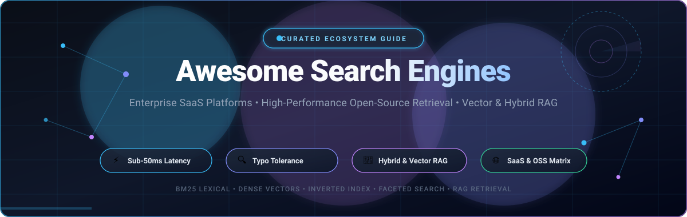
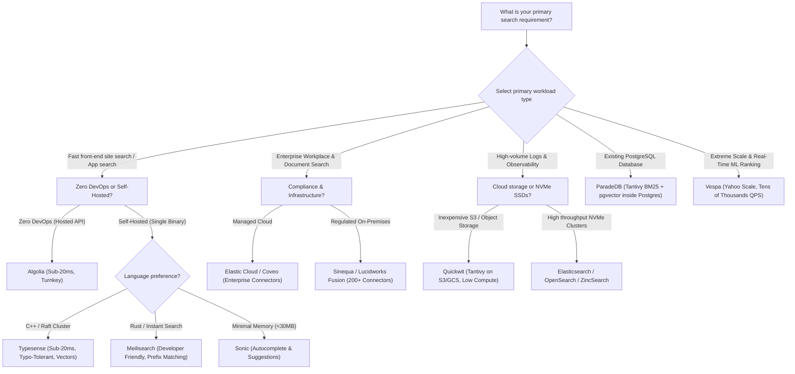

<p align="center">
  
</p>

<p align="center">
  <a href="https://github.com/ishandutta2007/Awesome-Awesome-Awesome"></a><a href="https://discord.gg/jc4xtF58Ve"></a>
  <a href="https://github.com/ishandutta2007/Awesome-Search-Engines/stargazers"></a>
  <a href="https://github.com/ishandutta2007/Awesome-Search-Engines/network/members"></a>
  <a href="https://github.com/ishandutta2007/Awesome-Search-Engines/issues"></a>
  <a href="https://github.com/ishandutta2007/Awesome-Search-Engines/blob/main/LICENSE"></a>
  <a href="https://github.com/ishandutta2007/Awesome-Search-Engines/pulls"></a>
  <a href="https://github.com/ishandutta2007"></a>
</p>

---

# 🔍 Awesome Search Engines

A curated ecosystem guide to high-performance **Search Engines**, **Enterprise SaaS Discovery Platforms**, and **Open-Source Retrieval Systems**.

Covering typo-tolerant fuzzy matching, BM25 lexical inverted indices, dense vector similarity, and hybrid lexical-semantic RAG pipelines delivering sub-50ms query latencies for applications, e-commerce stores, and enterprise knowledge hubs.

---

## 📑 Table of Contents

- [📊 Sector Overview & Market Dynamics](#-sector-overview--market-dynamics)
- [☁️ SaaS & Hosted Platforms](#️-saas--hosted-platforms)
- [⚡ Quick Architectural Comparison](#-quick-architectural-comparison)
- [🐙 Open-Source GitHub Projects](#-open-source-github-projects)
  - [1. Elasticsearch](#1-elasticsearch-)
  - [2. Meilisearch](#2-meilisearch-)
  - [3. SearXNG](#3-searxng-)
  - [4. Typesense](#4-typesense-)
  - [5. Sonic](#5-sonic-)
  - [6. ZincSearch](#6-zincsearch-)
  - [7. Tantivy](#7-tantivy-)
  - [8. OpenSearch](#8-opensearch-)
  - [9. Manticore Search](#9-manticore-search-)
  - [10. Quickwit](#10-quickwit-)
  - [11. Bleve](#11-bleve-)
  - [12. ParadeDB](#12-paradedb-)
  - [13. Vespa](#13-vespa-)
  - [14. Apache Lucene](#14-apache-lucene-)
  - [15. Apache Solr](#15-apache-solr-)
  - [16. Xapian](#16-xapian-)
- [💡 Architectural Decision Guide](#-architectural-decision-guide)
- [🤝 How to Contribute](#-how-to-contribute)
- [📈 Star History](#-star-history)
- [📜 License & Disclaimer](#-license--disclaimer)

---

## 📊 Sector Overview & Market Dynamics

The global enterprise search and cognitive retrieval software market is estimated at **$5.5 Billion to $7.5 Billion (2025–2026)** and is projected to expand past **$11.6 Billion by 2031** at a compound annual growth rate (CAGR) of **9.3% to 12.5%**, propelled by enterprise migration toward generative AI orchestration, vector databases, and Retrieval-Augmented Generation (RAG).

Unlike winner-take-all consumer web search, this sector is **moderately to highly fragmented** across distinct functional domains. The competitive landscape divides into cloud hyperscalers offering managed infrastructure (AWS OpenSearch, Azure AI Search, Google Cloud Vertex), enterprise knowledge retrieval platforms with deep corporate connectors (Coveo, Sinequa, Lucidworks), specialized e-commerce merchandising and product discovery suites (Bloomreach, Searchspring), developer-centric Search-as-a-Service APIs (Algolia), and rapidly maturing self-hosted open-source retrieval engines (Typesense, Meilisearch, Elasticsearch, Quickwit) that give engineering teams strict data sovereignty and predictable cost controls.

---

## ☁️ SaaS & Hosted Platforms

The following hosted search platforms provide turnkey indexing, relevance tuning, and infrastructure management. Sorted in **descending order by company size (market valuation / ARR)**.

| Platform | Company Scale (Valuation / Revenue) | Starting Pricing Tier | Free Forever Plan / Free Trial Limits | Primary Focus & Capabilities |
| :--- | :--- | :--- | :--- | :--- |
| **[Amazon OpenSearch Service](https://aws.amazon.com/opensearch-service/)** | **~$2.1 Trillion Market Cap**<br>*(AWS ~$105B+ Annual Revenue)* | **$0.036 / hour**<br>(~$26.28/month for `t3.small.search` instance + $0.10/GB-month EBS; Serverless starts at $0.24 / OCU-hour) | **750 hours/month** of single-AZ `t2.small.search` or `t3.small.search` instance + **10 GB optional EBS storage for 12 months** on AWS Free Tier | Fully managed AWS OpenSearch & legacy Elasticsearch clusters with automated scaling, VPC security, CloudWatch integration, and serverless vector indexing. |
| **[Elastic Cloud (Swiftype)](https://www.elastic.co/enterprise-search)** | **~$9.8 Billion Market Cap**<br>*(NYSE: ESTC; ~$1.7B Annual Revenue)* | **$99.00 / month**<br>($0.1378/hr for Standard managed cluster) or **$95.00 / month** on Elasticsearch Serverless | **14-day fully featured free trial** with full access to App Search, Workplace Search, Elasticsearch, and Kibana (no credit card required) | Enterprise workplace search, log analytics, cross-cluster replication, and dense vector similarity search built directly on Apache Lucene. |
| **[Algolia](https://www.algolia.com/)** | **$2.25 Billion Valuation**<br>*(Series D; ~$100M+ ARR)* | **$0.50 / 1K requests + $0.40 / 1K records/mo**<br>(Grow tier with $0 base platform fee; $1.75/1K requests on Grow Plus with AI features) | **Free Forever ("Build" Plan)**:<br>**10,000 search requests/month**, **50,000 records** (up to 10 KB/record), 5,000 recommendation requests, and 5,000 crawler runs/month | Developer-favorite instant search API with sub-20ms search-as-you-type, built-in typo tolerance, front-end InstantSearch UI libraries, and NeuralSearch. |
| **[Bloomreach](https://www.bloomreach.com/)** | **$2.20 Billion Valuation**<br>*(Series F; ~$260M+ ARR)* | **~$5,000 / month**<br>(Entry-level enterprise contracts starting from ~$60,000/year billed annually based on Monthly Unique Visitors [MUV] & SKU volume) | **30-day customized Proof of Concept (PoC) / sandbox evaluation** with sales engineering scoping (no self-serve freemium) | Enterprise AI-powered e-commerce product discovery, merchandising algorithms, visual curation, personalized ranking, and Loomi AI commerce agents. |
| **[Coveo](https://www.coveo.com/)** | **~$380 Million Market Cap**<br>*(TSX: CVO; ~$148M Annual Revenue)* | **$990.00 / month**<br>(Billed annually on multi-year terms for baseline Salesforce Pro+ ecosystem connector tier) | **14-day free trial** of the Coveo AI Relevance Platform with test index and machine learning relevance pipelines (no credit card required) | Unified cognitive AI search for customer service desks (Salesforce, ServiceNow, Zendesk), internal workplace knowledge portals, and large enterprise catalogs. |
| **[Lucidworks Fusion](https://lucidworks.com/)** | **$210 Million Total Funding**<br>*(~$45M–$70M Annual Revenue)* | **~$2,333 / month**<br>(Starting annual enterprise contracts from ~$28,000/year based on query volume, collection size, and deployment model) | **30-day scoped Proof of Concept (PoC) / sandbox pilot** including guided ROI assessment and query pipeline configuration | Enterprise search platform built on Apache Solr with visual query and indexing pipelines, machine learning clickstream re-ranking, and hybrid generative RAG. |
| **[Sinequa](https://www.sinequa.com/)** | **€85 Million ($90M) Acquisition Valuation**<br>*(ChapsVision; ~$25M–$35M Annual Revenue)* | **~$2,500 / month**<br>(Commercial enterprise licenses starting from ~$30,000/year based on indexed document volume and user seat tier) | **30-to-60 day enterprise Proof of Concept (PoC) sandbox** connecting up to 5 enterprise content silos under strict security boundary testing | Enterprise cognitive search and generative AI platform tailored for regulated industries (pharma, defense, aerospace) with 200+ out-of-the-box secure connectors. |
| **[Searchspring](https://searchspring.com/)** | **Private Equity Backed**<br>*(Athos Commerce; ~$20M–$30M Annual Revenue)* | **$599.00 / month**<br>(Essential plan on BigCommerce and Shopify app marketplaces) scaling with product catalog SKU count and monthly search queries | **14-day assisted free trial & sandbox store demo** for BigCommerce and Shopify merchant environments | E-commerce site search, visual category merchandising, faceted filtering, product bundling, and real-time conversion rate optimization for online stores. |

---

## ⚡ Quick Architectural Comparison

| Engine | Primary Language | Inverted Index Core | Typo Tolerance | Vector / Hybrid RAG | Deployment Model | Typical Query Latency |
| :--- | :--- | :--- | :--- | :--- | :--- | :--- |
| **Elasticsearch** | Java | Apache Lucene | Fuzzy Query / Levenshtein | HNSW Dense Vectors + BM25 | Clustered JVM | 10ms – 50ms |
| **Meilisearch** | Rust | Custom Inverted Index | Built-in Prefix Damerau-Levenshtein | Vector Embeddings + Hybrid | Single Binary / Cloud | < 20ms |
| **SearXNG** | Python | Metasearch Aggregator | Engine-level Pass-through | External Semantic Rerank | Containerized Gateway | 200ms – 600ms |
| **Typesense** | C++ | In-Memory Inverted Index | Built-in Typo Levenshtein (0/1/2) | Built-in HNSW Vector + Lexical | Single Binary / Raft Cluster | < 20ms |
| **Sonic** | Rust | In-Memory Channel Index | Lightweight Levenshtein Autocomplete | Lexical Identifier Only | Micro-daemon (<30MB RAM) | < 5ms |
| **ZincSearch** | Go | Bluge / Inverted Index | Basic Levenshtein Matching | Text BM25 Lexical | Single Binary (<100MB RAM) | 10ms – 40ms |
| **Tantivy** | Rust | Native Rust Lucene Alternative | Levenshtein Automaton | Vector Extension / Tantivy-py | Embedded Engine Library | < 10ms |
| **OpenSearch** | Java | Apache Lucene | Lucene Fuzzy Automata | k-NN Plugin (HNSW, Faiss, NMSLIB) | Clustered JVM / Serverless | 15ms – 60ms |
| **Manticore Search** | C++ | Columnar & Inverted Index | Built-in Levenshtein & Double Metaphone | HNSW Vector Search + SQL | Native C++ Daemon | < 15ms |
| **Quickwit** | Rust | Tantivy on Cloud Object Storage | Tantivy Tokenizer Matching | Native Vector & SPLADE Search | Distributed Object Storage | 50ms – 300ms |
| **Bleve** | Go | Upsidedown / Scorch Index | Levenshtein Fuzzy Search | Go Vector Extensible | Embedded Go Library | < 15ms |
| **ParadeDB** | Rust / C | Tantivy inside PostgreSQL | Tantivy BM25 / Fuzzy Matching | pgvector + Tantivy Hybrid BM25 | PostgreSQL Extension | < 25ms |
| **Vespa** | C++ / Java | Custom Real-Time Index | Dictionary & Gram Matching | Native Multi-vector + Lexical + GBDT | Scalable Multi-Node Cluster | < 15ms |
| **Apache Lucene** | Java | Inverted Index Standard | Automaton Query / Levenshtein | KnnFloatVectorField (HNSW) | In-Process Java Library | < 10ms |
| **Apache Solr** | Java | Apache Lucene | Fuzzy Search / Spellcheck | DenseVectorField / HNSW | Clustered SolrCloud (ZooKeeper) | 15ms – 50ms |
| **Xapian** | C++ | Glass / Inverted Database | Edit Distance Stemming | Probabilistic IR (BM25 / BM25+) | Native C++ Library | < 15ms |

---

## 🐙 Open-Source GitHub Projects

Explore the most prominent open-source search engines, libraries, and retrieval platforms. Sorted in **descending order by GitHub star count**.

### 1. [Elasticsearch](https://github.com/elastic/elasticsearch) [](https://github.com/elastic/elasticsearch/stargazers)
- **License:** SSPL 1.0 / Elastic License 2.0 | **Primary Language:** Java
- **Core Architecture:** Distributed JSON document store built on top of Apache Lucene. Employs an inverted index with BM25 scoring alongside HNSW dense vector indexing.
- **Key Capabilities:**
  - Industry-standard query DSL supporting complex aggregations, geo-queries, parent-child joins, and text analyzers.
  - Hybrid lexical-semantic retrieval combining BM25 keyword matching with dense kNN vector embeddings via Reciprocal Rank Fusion (RRF).
  - Native observability and time-series optimizations with index lifecycle management (ILM) and Prometheus PromQL compatibility.
- **Best For:** Enterprise search, security information and event management (SIEM), and large-scale log analytics workloads.
- **Quickstart:**
  ```bash
  docker run -p 9200:9200 -e "discovery.type=single-node" -e "xpack.security.enabled=false" docker.elastic.co/elasticsearch/elasticsearch:8.15.0
  ```

---

### 2. [Meilisearch](https://github.com/meilisearch/meilisearch) [](https://github.com/meilisearch/meilisearch/stargazers)
- **License:** MIT | **Primary Language:** Rust
- **Core Architecture:** Lightweight, memory-efficient search engine written in Rust using LMDB as its underlying key-value storage engine.
- **Key Capabilities:**
  - Instant search-as-you-type with typical response latencies below 20ms out of the box.
  - Intelligent typo tolerance handling character transpositions, substitutions, omissions, and insertions automatically.
  - Vector search and hybrid retrieval with automatic document embedding via external AI models (OpenAI, HuggingFace, Ollama).
  - Multi-tenant tenant tokens for granular security filtering at the search-token level.
- **Best For:** Developer-facing site search, web and mobile app search boxes, SaaS catalogs, and digital documentation portals.
- **Quickstart:**
  ```bash
  docker run -it --rm -p 7700:7700 -v $(pwd)/meili_data:/meili_data getmeili/meilisearch:v1.10
  ```

---

### 3. [SearXNG](https://github.com/searxng/searxng) [](https://github.com/searxng/searxng/stargazers)
- **License:** AGPL-3.0 | **Primary Language:** Python
- **Core Architecture:** Privacy-respecting, metasearch engine gateway aggregating results from over 70 search services without tracking user queries.
- **Key Capabilities:**
  - Queries multiple search engines (Google, Bing, DuckDuckGo, Wikipedia, GitHub, Arxiv) simultaneously and de-duplicates results.
  - Anonymizes outbound user requests by stripping profiling cookies, tracking parameters, and referrers.
  - Provides a clean JSON API interface to build search-augmented LLM pipelines and privacy-first browser search endpoints.
- **Best For:** Privacy-conscious personal search gateways, autonomous research agents, and anonymous multi-engine data aggregation.
- **Quickstart:**
  ```bash
  docker run -d --name searxng -p 8080:8080 -v $(pwd)/searxng:/etc/searxng searxng/searxng:latest
  ```

---

### 4. [Typesense](https://github.com/typesense/typesense) [](https://github.com/typesense/typesense/stargazers)
- **License:** GPL-3.0 | **Primary Language:** C++
- **Core Architecture:** In-memory inverted index written in C++ with asynchronous disk persistence (RocksDB) and Raft-based distributed consensus.
- **Key Capabilities:**
  - Deterministic typo tolerance calibrated for fast keystroke-by-keystroke interactive search with sub-20ms latencies.
  - Native vector search with built-in HNSW index and hybrid search scoring (lexical BM25 + dense vector embeddings) within a single query API.
  - Geospatial filtering and polygon geosearch (`filter_by=location:(48.85, 2.35, 10 km)`), dynamic faceting, sorting, and merchandising curation.
  - Single zero-dependency binary with native client SDKs for JavaScript, Python, Go, PHP, Java, Ruby, C#, Swift, and Dart.
- **Best For:** High-traffic e-commerce storefronts, SaaS application search, geo-directory lookups, and self-hosted Algolia replacements.
- **Quickstart:**
  ```bash
  docker run -p 8108:8108 -v $(pwd)/typesense-data:/data typesense/typesense:27.1 --data-dir=/data --api-key=xyz --enable-cors
  ```

---

### 5. [Sonic](https://github.com/valeriansaliou/sonic) [](https://github.com/valeriansaliou/sonic/stargazers)
- **License:** MPL-2.0 | **Primary Language:** Rust
- **Core Architecture:** Ultra-minimalist, schema-less search backend written in Rust acting as an index identifier broker rather than a document store.
- **Key Capabilities:**
  - Microscopic resource footprint: runs smoothly in tens of megabytes of RAM (often < 30MB).
  - Uses the lightweight Sonic Channel Protocol (over raw TCP sockets) with commands like `PUSH`, `QUERY`, `SUGGEST`, and `PING`.
  - In-memory index backed by persistent RocksDB storage, optimized for autocomplete suggestions and real-time typo correction.
- **Best For:** Autocomplete dropdowns, instant search suggestions, microservices, and constrained IoT or edge deployments.
- **Quickstart:**
  ```bash
  docker run -p 1491:1491 -v $(pwd)/sonic.cfg:/etc/sonic.cfg -v $(pwd)/sonic_data:/var/lib/sonic/store/ valeriansaliou/sonic:v1.4.9
  ```

---

### 6. [ZincSearch](https://github.com/zincsearch/zincsearch) [](https://github.com/zincsearch/zincsearch/stargazers)
- **License:** Apache-2.0 | **Primary Language:** Go
- **Core Architecture:** Modern search engine built in Go using the Bluge indexing library and BadgerDB key-value storage engine.
- **Key Capabilities:**
  - Drastic memory reduction compared to Elasticsearch (operates in < 100MB RAM without JVM heap tuning).
  - Elasticsearch-compatible ingestion APIs (`_bulk`, `_search`), allowing drop-in ingestion from Fluentbit, Logstash, or Vector.
  - Built-in embedded web management UI for querying indices, configuring schemas, and monitoring ingest rates.
- **Best For:** Lightweight server log search, small-to-medium DevOps observability stacks, and low-footprint application search.
- **Quickstart:**
  ```bash
  docker run -p 4080:4080 -e "ZINC_FIRST_ADMIN_USER=admin" -e "ZINC_FIRST_ADMIN_PASSWORD=ComplexPassword123" public.ecr.aws/zinclabs/zincsearch:latest
  ```

---

### 7. [Tantivy](https://github.com/quickwit-oss/tantivy) [](https://github.com/quickwit-oss/tantivy/stargazers)
- **License:** MIT / Apache-2.0 | **Primary Language:** Rust
- **Core Architecture:** Pure Rust full-text search engine library inspired by Apache Lucene, emphasizing raw indexing and search throughput.
- **Key Capabilities:**
  - Highly optimized SIMD-accelerated bit-packing, posting list compression, and finite state transducer (FST) dictionary terms.
  - Outperforms Lucene in raw indexing throughput and query latency benchmarks while consuming less memory.
  - Serves as the core indexing foundation powering Quickwit, ParadeDB, and numerous high-performance Rust search tools.
- **Best For:** Systems programmers building custom search engines, desktop search utilities, embedded applications, and Rust data pipelines.
- **Quickstart (Rust Cargo):**
  ```toml
  [dependencies]
  tantivy = "0.22"
  ```

---

### 8. [OpenSearch](https://github.com/opensearch-project/OpenSearch) [](https://github.com/opensearch-project/OpenSearch/stargazers)
- **License:** Apache-2.0 | **Primary Language:** Java
- **Core Architecture:** Fully open-source community fork of Elasticsearch 7.10.2 and Kibana led by AWS, maintaining Apache 2.0 licensing.
- **Key Capabilities:**
  - Full-text search with Lucene BM25, distributed sharding, multi-node clustering, and aggregations.
  - Integrated k-NN vector search plugin supporting HNSW and IVF algorithms via Faiss, NMSLIB, and Lucene engines.
  - Security plugin included out-of-the-box (TLS encryption, role-based access control, active directory / LDAP integration).
- **Best For:** Organizations requiring 100% OSI-approved Apache-2.0 licensing for enterprise search, log monitoring, and vector RAG.
- **Quickstart:**
  ```bash
  docker run -p 9200:9200 -e "discovery.type=single-node" -e "DISABLE_SECURITY_PLUGIN=true" opensearchproject/opensearch:2.15.0
  ```

---

### 9. [Manticore Search](https://github.com/manticoresoftware/manticoresearch) [](https://github.com/manticoresoftware/manticoresearch/stargazers)
- **License:** GPL-2.0 | **Primary Language:** C++
- **Core Architecture:** High-speed SQL-native search engine originating as a fork of Sphinx Search, rewritten in modern C++ with columnar storage.
- **Key Capabilities:**
  - Native MySQL protocol support: query search indices using standard SQL syntax (`SELECT * FROM index WHERE MATCH('query')`).
  - Columnar docstore format reducing RAM usage by up to 4x to 8x compared to Elasticsearch.
  - Real-time indexing, distributed cluster scaling, geospatial geo-distance calculations, and integrated HNSW vector search.
- **Best For:** Teams wanting SQL-native search querying without learning complex DSLs, Sphinx migrations, and high-concurrency workloads.
- **Quickstart:**
  ```bash
  docker run -p 9306:9306 -p 9308:9308 manticoresearch/manticore:latest
  ```

---

### 10. [Quickwit](https://github.com/quickwit-oss/quickwit) [](https://github.com/quickwit-oss/quickwit/stargazers)
- **License:** AGPL-3.0 / Apache-2.0 | **Primary Language:** Rust
- **Core Architecture:** Cloud-native search engine designed to execute sub-second search directly on cloud object storage (Amazon S3, Google Cloud Storage, Azure Blob).
- **Key Capabilities:**
  - Decoupled storage and compute architecture, enabling near-zero idle compute costs and petabyte-scale retention on inexpensive object storage.
  - Built on the Tantivy search library with full Elasticsearch-compatible search API (`_search`) and Jaeger-compatible tracing endpoints.
  - Native vector similarity search, SPLADE learned sparse representations, and high-throughput streaming Kafka / Kinesis indexing.
- **Best For:** High-volume log search, distributed OpenTelemetry trace analytics, security event storage, and cost-optimized cold search.
- **Quickstart:**
  ```bash
  docker run -p 7280:7280 quickwit/quickwit:latest run
  ```

---

### 11. [Bleve](https://github.com/blevesearch/bleve) [](https://github.com/blevesearch/bleve/stargazers)
- **License:** Apache-2.0 | **Primary Language:** Go
- **Core Architecture:** Modern text indexing and search library written natively in pure Go, with pluggable storage backends (BoltDB, Badger, LevelDB).
- **Key Capabilities:**
  - Advanced text analyzers, stemmers, tokenizers, and character filters for over 20 human languages.
  - Supports term queries, phrase queries, fuzzy Levenshtein matching, wildcard prefixes, and numeric / date range facets.
  - Powers full-text search capabilities in distributed Go platforms such as Couchbase.
- **Best For:** Go applications requiring embedded full-text indexing without spawning an external JVM or standalone search cluster.
- **Quickstart (Go Module):**
  ```bash
  go get -u github.com/blevesearch/bleve/v2
  ```

---

### 12. [ParadeDB](https://github.com/paradedb/paradedb) [](https://github.com/paradedb/paradedb/stargazers)
- **License:** AGPL-3.0 / Apache-2.0 | **Primary Language:** Rust / C
- **Core Architecture:** Elastic-grade full-text search engine and columnar analytics engine built as a native PostgreSQL extension using Tantivy.
- **Key Capabilities:**
  - Integrates BM25 scoring directly inside standard Postgres tables via `pg_search` without running a separate search cluster.
  - Unifies relational SQL queries, joins, ACID transactions, Tantivy BM25 full-text ranking, and `pgvector` semantic vector search.
  - Eliminates the need for dual-write ETL synchronization pipelines between Postgres databases and external Elasticsearch clusters.
- **Best For:** Engineering teams using PostgreSQL who want Elasticsearch-quality search and hybrid RAG directly inside their primary database.
- **Quickstart:**
  ```bash
  docker run -p 5432:5432 -e POSTGRES_PASSWORD=password paradedb/paradedb:latest
  ```

---

### 13. [Vespa](https://github.com/vespa-engine/vespa) [](https://github.com/vespa-engine/vespa/stargazers)
- **License:** Apache-2.0 | **Primary Language:** C++ / Java
- **Core Architecture:** Yahoo's high-scale distributed platform for real-time vector search, lexical text search, and multi-stage machine learning ranking.
- **Key Capabilities:**
  - Evaluates complex ML ranking models (gradient boosted decision trees, neural rankers, ONNX models) in parallel during query evaluation.
  - Handles billions of documents and hundreds of thousands of queries per second with single-digit millisecond latency.
  - Native support for tensor computations, multi-vector embeddings, BM25 scoring, and real-time document updates.
- **Best For:** Mission-critical search systems, large-scale recommendation engines, and high-concurrency neural RAG retrieval architectures.
- **Quickstart:**
  ```bash
  docker run -p 8080:8080 -p 19071:19071 --name vespa vespaengine/vespa
  ```

---

### 14. [Apache Lucene](https://github.com/apache/lucene) [](https://github.com/apache/lucene/stargazers)
- **License:** Apache-2.0 | **Primary Language:** Java
- **Core Architecture:** The foundational high-performance, full-featured text search engine library in Java that powers Elasticsearch, Solr, and OpenSearch.
- **Key Capabilities:**
  - World-class inverted index structure, positional index encoding, postings list compression, and finite state automata for prefix matching.
  - BM25 similarity scoring, doc-values for fast sorting and aggregations, and Lucene 9+ native HNSW dense vector field indexing.
  - Extensive language tokenization, stemming, phonetic filters, and customizable query parsers.
- **Best For:** Low-level search infrastructure engineering, custom in-process search pipelines, and Java applications requiring direct index control.
- **Quickstart (Maven):**
  ```xml
  <dependency>
      <groupId>org.apache.lucene</groupId>
      <artifactId>lucene-core</artifactId>
      <version>9.11.1</version>
  </dependency>
  ```

---

### 15. [Apache Solr](https://github.com/apache/solr) [](https://github.com/apache/solr/stargazers)
- **License:** Apache-2.0 | **Primary Language:** Java
- **Core Architecture:** Mature, battle-tested distributed enterprise search platform built on Apache Lucene with over 19 years of production deployments.
- **Key Capabilities:**
  - SolrCloud architecture coordinating distributed indexing and failover across multi-node clusters using Apache ZooKeeper.
  - Advanced faceting, hit highlighting, phonetic matching, geospatial search, and rich document parsing (PDF, Word, HTML via Apache Tika).
  - Dense vector similarity search integration and machine-learned ranking (LTR) plugins.
- **Best For:** Established enterprise search deployments, complex document management systems, and legacy Lucene ecosystem infrastructures.
- **Quickstart:**
  ```bash
  docker run -p 8983:8983 -d solr:9.6.1 solr-demo
  ```

---

### 16. [Xapian](https://github.com/xapian/xapian) [](https://github.com/xapian/xapian/stargazers)
- **License:** GPL-2.0 | **Primary Language:** C++
- **Core Architecture:** Highly adaptable probabilistic Information Retrieval (IR) library written in C++ implementing the BM25 and BM25+ ranking models.
- **Key Capabilities:**
  - Probabilistic relevance ranking with boolean search operators, phrase searches, wildcard expansion, and document clustering.
  - Edit-distance spelling correction, dynamic snippet generation, and synonym matching.
  - Bindings available for Perl, Python, PHP, Java, Ruby, Tcl, and C#.
- **Best For:** Embedded desktop search utilities, mail client search backends (e.g., Notmuch), and C++ desktop document retrieval tools.

---

## 💡 Architectural Decision Guide



---

## 🤝 How to Contribute

Contributions are warmly welcomed! Help keep this search engine ecosystem guide accurate and up-to-date:

1. 🍴 **Fork the Repository** on GitHub.
2. 🌿 **Create a Feature Branch** (`git checkout -b feature/new-search-engine`).
3. 📝 **Add or Update Entries**:
   - Provide the project name, repository link, and live star badge for open-source tools.
   - For SaaS products, include verifiable starting prices and specific free tier / trial terms.
   - Summarize core architecture, licensing, and key use cases factually.
4. 🚀 **Submit a Pull Request** with a concise description of your changes.

---

## 📈 Star History

[](https://star-history.dera.page/#ishandutta2007/Awesome-Search-Engines&type=date&legend=top-left)

---

## 📜 License & Disclaimer

- **License:** Licensed under the [MIT License](LICENSE).
- **Disclaimer:** All product names, logos, and brands are property of their respective owners. Inclusion in this repository represents an objective architectural overview and does not imply endorsement.
